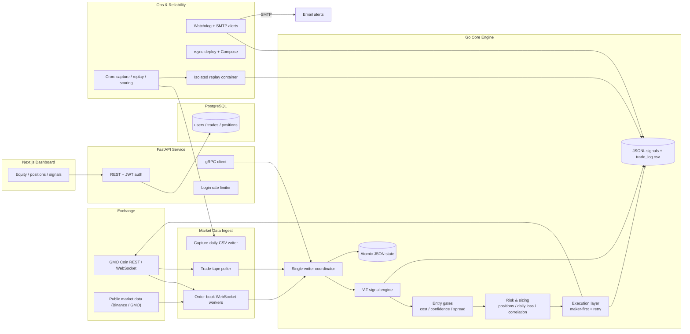
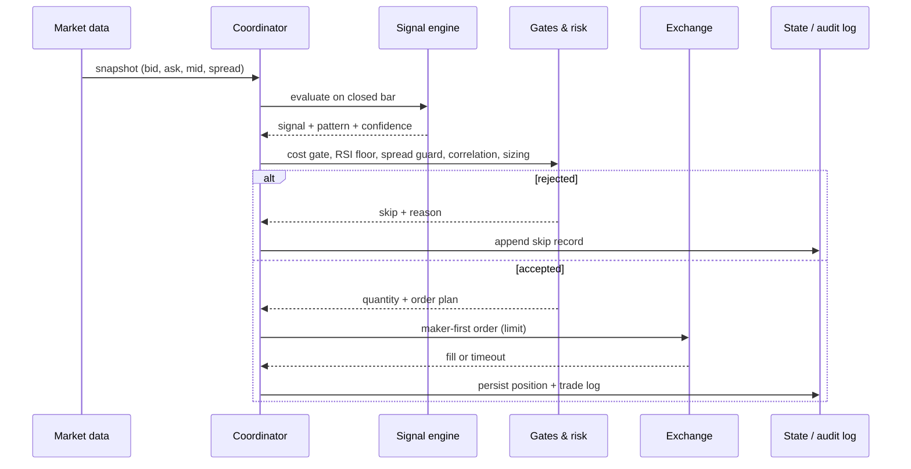

# CryptoEngine

**A 24/7 event-driven trading and execution platform — built for deterministic state, fail-safe operation, and low-footprint deployment on a single VPS.**

CryptoEngine is an end-to-end system rather than a collection of trading scripts. It ingests live market data, evaluates a technical strategy on closed bars, applies cost- and risk-aware execution gates, records every decision, and exposes the result through an API and a real-time dashboard. The same codebase supports **dry-run**, **historical replay**, and **live execution**, with live trading disabled unless an explicit safety switch is provided.

The project is intentionally opinionated about reliability: the execution loop owns all mutable state in one goroutine, every order passes through layered fail-safes, and the system keeps running when the database or exchange is temporarily unavailable.

> **Portfolio snapshot.** This public repository has been sanitized: no exchange credentials, account data, private keys, webhook URLs, or production host identifiers are included. Live execution is disabled by default.

---

## Project Overview

Most retail trading bots are single-file scripts that place orders and hope. CryptoEngine is designed like a production service:

- **Event-driven ingestion** of order-book streams and trade tape.
- **Deterministic signal evaluation** on closed candles, with higher-timeframe direction and lower-timeframe confirmation.
- **Cost-aware execution** — a trade must have enough expected movement to cover fees and spread.
- **Layered risk controls** — per-symbol position limits, portfolio caps, daily loss kill switch, stop-loss, max holding time, and correlation clustering.
- **Auditability** — every signal, skip, order, fill, and state transition is written to an append-only log.
- **Research loop** — historical replay, bootstrap confidence intervals, acceptance gates, and ablation studies, so strategy changes are measured rather than assumed.
- **Operational discipline** — heartbeat monitoring, watchdog alerts, bounded resource usage, and a deploy pipeline that refuses to ship secrets.

The result is a system that a small team can operate on a 2 GB VPS while retaining the safety properties usually associated with much larger trading stacks.

---

## What This Demonstrates

For a CTO or founder evaluating end-to-end ownership, this repository shows:

| Capability | Evidence in the codebase |
|---|---|
| Backend engineering | Go execution engine, FastAPI service, gRPC boundary, PostgreSQL |
| Concurrency & state | Single-writer coordinator, atomic state snapshots, restart recovery |
| Reliability engineering | Dry-run default, kill switches, watchdog, retry policy, maintenance-window guard |
| Quantitative rigor | Replay engine, bootstrap PF confidence intervals, acceptance criteria, ablation |
| Frontend delivery | Next.js dashboard with equity, positions, signals, and market context |
| Infrastructure | Docker Compose, resource limits, cron orchestration, rsync deploy with secret checks |
| Security hygiene | No secrets in source, `.env.example` templates, ignored key/log directories |

---

## Key Architectural Highlights

### 1. Event-driven core with a single-writer state machine

The live loop follows a strict ownership model:

- **Workers** consume WebSocket order-book streams and forward immutable snapshots.
- **One coordinator goroutine** owns positions, pending maker orders, daily P&L, and all state transitions.
- No shared mutable state and no lock contention on the trading path.

Because decisions happen on **closed bars** (5-minute by default), throughput is bounded and deterministic. The coordinator can therefore prioritize correctness over raw parallelism: every decision sees a consistent snapshot of the world.

### 2. Cost-aware execution, not just signal-aware

A technically valid signal can still lose money after fees and spread. The execution layer includes a **cost gate**:

```
allow entry only if:
    ATR ratio >= k × (entry fee + exit fee + average spread)
```

- `k` is configurable (`--cost-gate-k`).
- Fee mode is explicit: `taker`, `maker`, or `conservative`.
- If ATR is unknown or the candle history is insufficient, the gate **fails closed** — the system does not guess.

Additional execution filters include minimum confidence, an oversold-short floor, a spread-spike guard, entry cooldown, and correlation-aware position caps. These are applied at the execution/recording layer, so the core signal logic remains reusable for research.

### 3. Retry strategy with explicit failure semantics

Exchange I/O is treated as unreliable by default:

- **Retryable errors** (network, timeout, transient 5xx): retried up to **3 attempts** with a capped backoff.
- **Business errors** (invalid order, rejected request, 4xx): fail fast — retrying cannot help.
- **Maintenance windows** are detected and skipped before an order is sent.
- **Symbol and lot-size validation** happens before the request; quantities are rounded down to the exchange step size and rejected if below the minimum.

The goal is not “retry everything.” It is to distinguish transient faults from deterministic rejections and avoid duplicate orders.

### 4. Fail-safe by default

The system is designed so that the safe state is the default state:

- **Dry-run unless `--live` is present.** Without it, the engine records intended actions and never calls the order endpoint.
- **Daily loss kill switch.** New entries stop when realized daily P&L crosses a configurable limit.
- **Position limits.** One position per symbol by default, plus a portfolio-wide maximum.
- **Exit protection.** Percentage stop-loss, ATR-based safety net, trailing stop, max holding time, and confirmation votes for weak exits.
- **Correlation clustering.** Highly correlated symbols share a cluster cap to avoid disguised concentration.
- **State recovery.** Open positions and daily P&L are persisted atomically and restored after a restart.
- **Watchdog.** Heartbeat freshness, container health, API health, daily P&L, maintenance windows, and error spikes are checked independently of the trading process.

### 5. State consistency and auditability

- **Atomic JSON snapshots** — write to a temporary file, then rename. A crash never leaves a half-written state file.
- **Append-only trade log** — fills are recorded as immutable CSV rows for audit and reconciliation.
- **JSONL signal records** — every evaluated signal, skip reason, and exit decision is preserved for replay and analysis.
- **Single source of truth for live state** — the coordinator is the only writer; workers and API handlers read snapshots.
- **Idempotent resume** — on restart, the engine reconciles persisted positions and continues rather than re-entering blindly.

### 6. Observability and alerting

The operational layer is deliberately simple and dependency-light:

- Heartbeat file updated on every loop iteration.
- Structured logs with skip reasons (`cost-gated`, `oversold short`, `spread spike`, etc.).
- Watchdog cron with SMTP alerts and a cooldown to prevent alert storms.
- Weekly research reports and replay summaries.
- Dashboard views for equity, positions, signals, and system state.

### 7. VPS-first deployment

The entire stack runs on a single small VPS:

- Docker Compose with health checks and explicit resource limits (e.g., 256 MB / 0.5 CPU for the execution container).
- Multi-stage builds for the Go core, FastAPI service, and Next.js dashboard.
- Cron jobs wrapped with `flock` and `nice` to avoid overlap and CPU contention.
- **Isolated replay containers** for counterfactual research: 1 CPU / 192 MB, no order path, read-only access to captured data.
- Deploy script performs a **pre-flight secret check** and aborts if an environment file or private key would be transferred.

> **Deployment note.** The deployment scripts ship with generic placeholders (`/opt/cryptoengine`, `203.0.113.10`, `deploy`). Override `APP_DIR` / `REMOTE_DIR`, `VPS_IP`, `VPS_USER`, and `SSH_ALIAS` through environment variables or `ops/scripts/config.env` for your own host. This keeps the public repository free of private infrastructure identifiers.

### 8. Research loop: replay, confidence intervals, acceptance gates

Strategy changes are validated before capital is exposed:

- **Historical replay** streams captured order-book CSV and trade tape through the same decision engine used live.
- **Bootstrap confidence intervals** (2,000 resamples) estimate the uncertainty of the profit factor.
- **Acceptance gate** requires a minimum number of round trips, a profit factor above a threshold, and a confidence-interval lower bound above 1.0.
- **Ablation studies** compare variants (with/without a filter, multiple cost-gate values, alternative timeframes) on identical windows.
- **Weekly counterfactual cron** keeps a versioned TSV of results so decisions are reproducible.

Live capital remains disabled until the acceptance gate is met. The public snapshot intentionally stays in dry-run.

---

## System Architecture

### Data and execution flow



### Trade lifecycle



---

## Tech Stack

| Layer | Technology | Notes |
|---|---|---|
| Execution core | **Go 1.25** | Goroutines, WebSocket streams, gRPC, `pgx` |
| API | **Python 3.12+ / FastAPI** | Async REST, JWT auth, SQLAlchemy, bcrypt |
| Dashboard | **Next.js / React / TypeScript** | Tailwind CSS, `lightweight-charts`, `three.js` |
| Database | **PostgreSQL 16** | API/dashboard data; execution state is file-based |
| Messaging | **gRPC** | API → core boundary when a core server is running; demo falls back to local data |
| Infrastructure | **Docker Compose** | Multi-stage builds, health checks, resource limits |
| Operations | **Bash / Python / cron** | Capture, replay, scoring, watchdog, retention |
| Testing | **Go test / pytest** | Engine, gates, acceptance, math, watchdog |
| CI | **GitHub Actions** | Go and Python test jobs on push/PR |

---

## Repository Layout

```text
.
├── backend/
│   ├── api/                 # FastAPI service (REST, auth, demo fallback)
│   └── core/                # Go execution engine and CLI
│       ├── capture/         # Order-book / tape capture
│       ├── usecase/trading/ # Exchange adapters, sizing, retry, V.T engine
│       ├── vt_live.go       # Live/dry-run coordinator
│       ├── vt_replay.go     # Historical replay
│       ├── vt_cost.go       # Cost gate, correlation, volatility scaling
│       ├── vt_acceptance.go # PF / bootstrap CI acceptance gate
│       └── vt_portfolio.go  # Portfolio-cap simulation
├── frontend/dashboard/      # Next.js dashboard
├── infra/
│   ├── config/              # Environment templates
│   └── docker/              # Dockerfiles and Compose files
├── ops/
│   ├── deploy/              # Deploy, cron, watchdog, security checks
│   └── scripts/             # Capture, replay, analysis, retention
├── tests/                   # Python tests
├── docker-compose.yml       # Local api/core/db stack
└── .github/workflows/ci.yml # Go + Python CI
```

---

## Setup & Demo Mode

The demo runs entirely on your machine. **No exchange API keys, real funds, or live endpoints are required.**

### Prerequisites

- Docker 24+ with Compose v2
- ~2 GB free RAM (the stack is intentionally small)
- Optional: Go 1.25 and Python 3.12+ for running tests directly

### 1. Clone and configure

```bash
git clone <repository-url> cryptoengine
cd cryptoengine/infra/docker

# Create a local environment file from the safe example.
cp ../config/.env.example ../config/.env
```

The example uses empty secrets and development defaults. For a local demo, that is sufficient: the database falls back to a local demo password, and `.env.example` sets `AUTH_ALLOW_DEV_SECRET=1` so the API can start with the built-in development JWT secret. The API explicitly **refuses** that fallback when `APP_ENV=prod`. For production, generate strong values with `openssl rand -hex 32` / `openssl rand -base64 24`.

### 2. Start the stack

```bash
docker compose up -d --build
```

This starts:

- `api` — FastAPI on **http://localhost:8000**
- `core` — Go execution container (idle by default; invoke CLI commands with `docker compose exec core core ...`)
- `db` — PostgreSQL 16 (internal)
- `frontend` — Next.js dashboard on **http://localhost:3001**

### 3. Open the dashboard

```bash
curl -s http://localhost:8000/health
open http://localhost:3001
```

If PostgreSQL is empty or unreachable, the API falls back to deterministic demo data so the dashboard is still useful. The API also falls back to local/demo paths when the gRPC core is not running; in the demo stack the core container is intentionally idle so you can invoke CLI commands directly.

### 4. Run the engine in dry-run

The `vtlive` service is behind the `trading` profile and **does not include `--live`** in this repository. It records intended actions without placing orders.

```bash
# Start the long-running dry-run coordinator
docker compose --profile trading up -d vtlive
docker compose logs -f vtlive
```

Or run a bounded dry-run directly in the core container:

```bash
docker compose exec core core vt-live \
  --symbols=LINK,LTC --bars=300 --seconds=600
```

Dry-run intents are written to `backend/core/trade_logs/vt_live_dryrun_*.jsonl`. No order endpoint is called.

### 5. Capture market data and replay

Public market data can be captured without API keys:

```bash
docker compose exec core core capture-daily \
  --exchange=gmo --symbol=BTC --seconds=540
```

Replay a captured date range through the same decision engine:

```bash
docker compose exec core core vt-replay \
  --symbol=BTC --bars=300 \
  --from=20261101 --to=20261107 \
  --balance-jpy=100000 --risk-fraction=0.2 \
  --out=/tmp/replay.jsonl
```

Score dry-run round trips with the acceptance gate:

```bash
docker compose exec core core vt-acceptance \
  --dir=/trade_logs --src=dryrun \
  --symbols=LINK,LTC --fee-mode=taker
```

`--src=dryrun` is required when scoring dry-run JSONL; without it, the command scores signal records instead.

### 6. Stop

```bash
docker compose --profile trading down
```

### What you can verify without API keys

- The API starts, authenticates, and serves demo data.
- The dashboard renders equity, positions, signals, and system state.
- The engine runs in dry-run and records decisions.
- Historical replay and acceptance scoring work on captured data.
- The watchdog reports heartbeat and health status.

---

## Live Trading Safety Model

Live execution is deliberately gated:

1. **Explicit switch.** `--live` must be present. The public snapshot and the default Compose command omit it.
2. **Risk envelope.** Live runs require explicit balance, risk fraction, daily loss limit, max positions, stop-loss, and max holding time.
3. **Exchange credentials.** Real API keys are provisioned only in the private environment; the repository ships only `.env.example`.
4. **Acceptance before capital.** The research gate requires a minimum number of round trips, a profit factor above threshold, and a bootstrap confidence-interval lower bound above 1.0.
5. **Operational monitoring.** A watchdog checks heartbeat freshness, container health, daily P&L, API health, maintenance windows, and error spikes.

> **Disclaimer.** This software is provided for research and engineering demonstration. It is not financial advice. Trading involves risk, including loss of principal. Use at your own risk.

---

## Testing & CI

```bash
# Go core
cd backend/core && go test ./...

# Python API / math / watchdog tests
python3 -m pytest -q

# Frontend type-check and production build (Node 20+)
cd frontend/dashboard && npm ci && npm run build
```

The GitHub Actions workflow (`.github/workflows/ci.yml`) runs the Go and Python suites on every push and pull request.

---

## Design Decisions & Trade-offs

| Decision | Rationale |
|---|---|
| **Single-writer coordinator** | Eliminates races and lock contention on the trading path; decisions are deterministic and easy to audit. Throughput is bounded by candle frequency, so parallelism is not the bottleneck. |
| **Dry-run by default** | The safe state is the default. Accidental live orders require an explicit flag and a configured risk envelope. |
| **File-based execution state** | Atomic JSON snapshots and an append-only trade log keep the engine independent of database availability. PostgreSQL serves the API and dashboard. |
| **Cost gate with ATR** | Rejects trades whose expected movement cannot cover fees plus spread; fails closed when volatility is unknown. |
| **Symbol-aware gating** | Out-of-sample tests showed that the same pattern can be a winner on one symbol and a loser on another. Blanket pattern bans were rejected in favor of cost, regime, and portfolio gates. |
| **Maker-first entries with timeout** | Reduces fees where possible, while a timeout fallback avoids missing entries in fast markets. |
| **Isolated replay containers** | Research runs in a separate, resource-capped container with no order path and read-only data access. |
| **Bounded polling + single coordinator** | Naturally paces exchange requests and avoids bursty API usage; retries are capped and limited to transient failures. |
| **Strict resource limits** | The full stack fits a 2 GB VPS with predictable latency and no swap thrash. |

---

## Security & Secret Hygiene

- **No credentials in source.** Only `.env.example` templates are tracked.
- **Ignored by default.** `.gitignore` excludes `.env*`, private keys, `ops/keys/`, logs, trade data, reports, database dumps, and build artifacts.
- **Deploy pre-flight check.** `ops/deploy/deploy-to-vps.sh` inspects the rsync transfer set and aborts if an environment file or private key would be sent.
- **Least privilege.** The execution container has a dedicated risk envelope; the replay container has no order path and runs with 1 CPU / 192 MB.
- **Audit trail.** Fills, skips, and state transitions are recorded for reconciliation.
- **Responsible disclosure.** Please report security issues privately via GitHub Security Advisories rather than opening a public issue.

---

## Roadmap

- Additional exchange adapters behind the existing executor interface.
- Prometheus metrics and Grafana dashboards for latency, fill rate, and skip reasons.
- Container image publishing and a GitHub Actions CD pipeline.
- Property-based tests for state-machine transitions and crash recovery.
- Optional WebSocket API for sub-second dashboard updates.

---

## License

MIT — see [LICENSE](LICENSE).

---

**Available for contract engagements via [Contra](https://contra.com).** If you need a backend engineer who can own a complex, reliability-sensitive system end to end — from Go services and data pipelines to deployment and observability — let’s talk.
